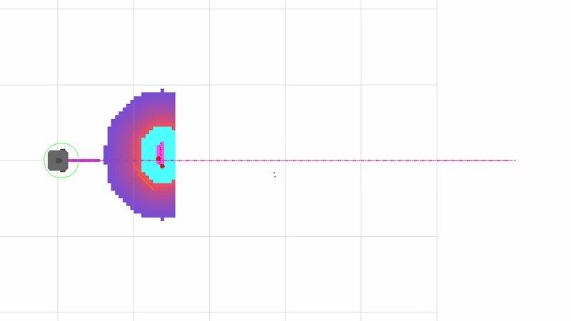
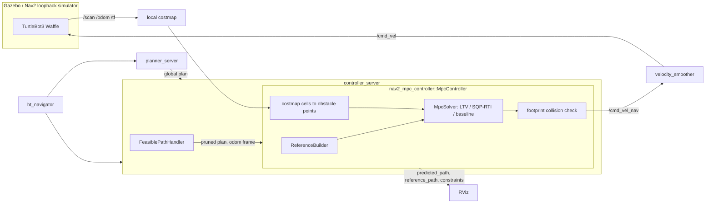
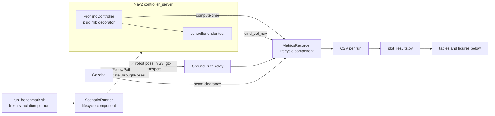
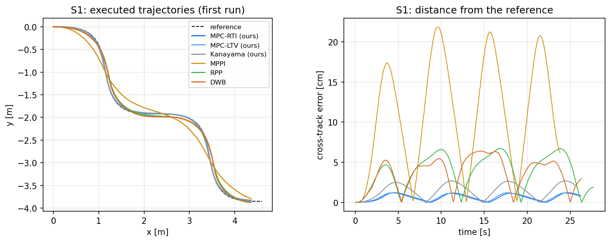
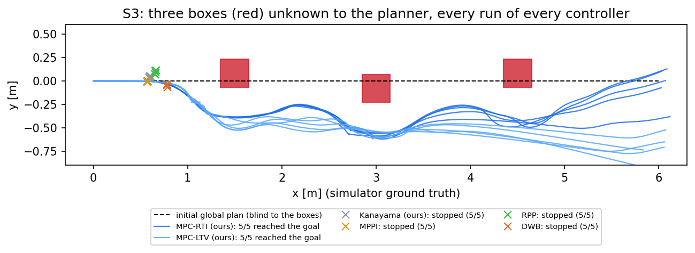
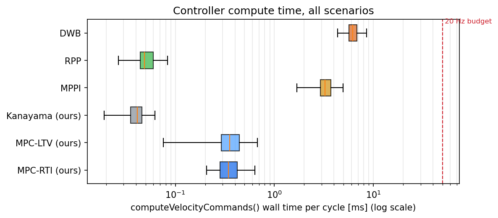
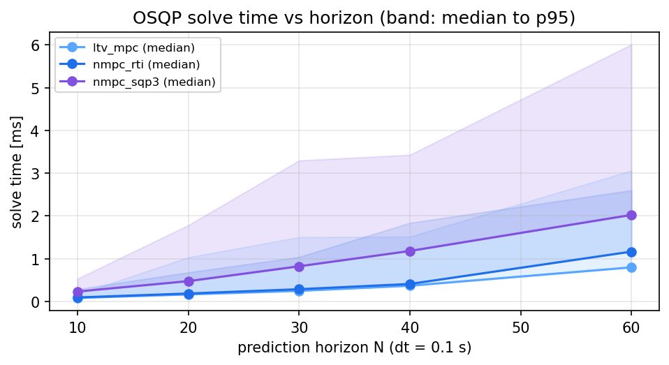

# nav2_mpc_controller

[](https://github.com/ssebba/nav2_mpc_controller/actions/workflows/ci.yml)


[](LICENSE)

**A Model Predictive Controller for [Nav2](https://nav2.org), written from scratch in C++20 on top
of [OSQP](https://osqp.org), and benchmarked in Gazebo against the Nav2 controllers MPPI, DWB and
Regulated Pure Pursuit.**

<p align="center">
  
</p>
<p align="center"><i>Scenario S3 at 2x speed: the planner's line (magenta) crosses three boxes it cannot
see; the MPC bends its prediction (orange) around each one, inside the local costmap.</i></p>

**Results in Gazebo** (5 runs per controller and scenario, details in [Benchmark](#benchmark)):

- **5.7x more accurate tracking** than the best Nav2 controller: 0.65 cm mean cross-track error,
  against 3.70 cm (DWB), 3.86 cm (RPP) and 11.1 cm (MPPI);
- **0.26-0.38 ms median per control cycle**, 8-14x less than MPPI and 16-22x less than DWB;
- **obstacles the planner cannot see are avoided inside the optimization**: 5/5 runs for the MPC,
  0/5 for MPPI, DWB and RPP (scenario S3, a stress test of the controller alone).

## Contents

- [Highlights](#highlights)
- [Quickstart](#quickstart)
- [Architecture](#architecture)
- [How the controller works](#how-the-controller-works)
- [Benchmark](#benchmark)
- [Design decisions](#design-decisions)
- [Testing and quality](#testing-and-quality)
- [Limitations and roadmap](#limitations-and-roadmap)

## Highlights

- **MPC from first principles**: sparse multiple-shooting QP solved with OSQP, two strategies
  sharing the same QP builder: linear time-varying MPC (LTV) and nonlinear MPC by Sequential
  Quadratic Programming / Real-Time Iteration (RTI).
- **Obstacle avoidance inside the optimization**: soft half-plane constraints built every cycle
  from the local costmap, with an exact (L1) penalty so the QP is always feasible.
- **Real-time by construction**: constant sparsity pattern (one OSQP setup, then value updates
  only), per-solve wall-clock budget, fallback on the shifted previous solution.
- **ROS-agnostic core**: the whole algorithm is a plain C++ library (`mpc_core`, Eigen + OSQP)
  with 78 unit tests; the Nav2 plugin is a thin wrapper.
- **Fair, reproducible benchmark**: same Nav2 configuration for every controller, same compute-time
  measurement through a pluginlib decorator, three scenarios in Gazebo, scripts for everything.
- **Modern ROS 2 engineering**: pluginlib plugins, lifecycle components, parameters declared and
  validated with `generate_parameter_library`, `launch_testing` integration tests, GitHub Actions
  CI (build with `-Werror`, tests, clang-tidy, clang-format), Docker and devcontainer.

## Quickstart

### Docker (one command)

```bash
git clone https://github.com/ssebba/nav2_mpc_controller.git && cd nav2_mpc_controller
docker compose up demo
```

Gazebo, RViz and Nav2 start with the MPC controller; send goals with the *Nav2 Goal* tool in RViz.
On Linux run `xhost +local:docker` once to allow the GUI; on Windows 11 WSLg works out of the box.

```bash
docker compose run --rm test        # build + all unit and integration tests, headless
docker compose run --rm benchmark   # full benchmark campaign, CSV files in ./results
```

### Native (ROS 2 Lyrical)

```bash
mkdir -p ~/ros_ws/src && cd ~/ros_ws/src
git clone https://github.com/ssebba/nav2_mpc_controller.git
cd ~/ros_ws && rosdep install --from-paths src --ignore-src -y
colcon build --cmake-args -DCMAKE_BUILD_TYPE=Release
source install/setup.bash
ros2 launch mpc_bringup demo.launch.py                    # Gazebo + RViz + MPC
ros2 launch mpc_bringup navigation.launch.py controller:=mppi simulator:=loopback   # any controller, no Gazebo
```

Controllers: `mpc_rti` (default), `mpc_ltv`, `baseline`, `mppi`, `rpp`, `dwb`.

## Architecture



| Package | Kind | Contents |
|---|---|---|
| [`mpc_core`](mpc_core) | pure C++ library (Eigen, OSQP) | unicycle model and Jacobians, reference builder, sparse QP builder, OSQP wrapper, LTV and SQP/RTI solvers, obstacle constraints, Kanayama baseline, closed-loop simulator, timing tool |
| [`nav2_mpc_controller`](nav2_mpc_controller) | `nav2_core::Controller` plugin | parameters (generate_parameter_library), costmap obstacle extraction, footprint collision check, rotate-to-heading, RViz debug topics |
| [`mpc_benchmark`](mpc_benchmark) | components + plugin | `ScenarioRunner`, `MetricsRecorder` (lifecycle components), `ProfilingController` (decorator plugin timing any Nav2 controller), `GroundTruthRelay` (robot pose from Gazebo through gz-transport), metrics library, campaign script |
| [`mpc_bringup`](mpc_bringup) | launch / config | Nav2 + TurtleBot3 for Gazebo or the loopback simulator, one YAML per controller, worlds, RViz, `launch_testing` integration tests |

## How the controller works

**Model.** Kinematic unicycle, state $x = [p_x, p_y, \theta]$, input $u = [v, \omega]$, discretized
with forward Euler, $\Delta t = 0.1$ s, horizon $N = 20$ (2 s).

**Reference.** The pruned plan is time-parametrized at the cruise speed: $N+1$ poses spaced by
$v_{ref}\,\Delta t$ from the projection of the robot on the path, yaw unwrapped around the robot
yaw, feed-forward commands $u^{ref}_k$ from consecutive samples. Near the goal the samples
collapse on the last pose, so the controller decelerates naturally.

**Optimal control problem**, solved every 50 ms:

$$
\min_{x,u,s}\ \sum_{k=1}^{N} \tfrac12\|x_k - r_k\|^2_{Q_k}
+ \sum_{k=0}^{N-1} \tfrac12\|u_k - u^{ref}_k\|^2_{R} + \tfrac12\|u_k - u_{k-1}\|^2_{R_\Delta}
+ \sum_{k=1}^{N} \rho_1 s_k + \tfrac12 \rho_2 s_k^2
$$

subject to the linearized dynamics $x_{k+1} = A_k x_k + B_k u_k + c_k$, input box and rate limits
(the first command over the 50 ms control period), and the obstacle half-planes
$n_{kj}^\top p_k + s_k \ge n_{kj}^\top o_{kj} + d_{safe}$, $s_k \ge 0$.

**Sparse QP.** Decision vector $z = [x_0..x_N, u_0..u_{N-1}, s_1..s_N]$ (123 variables, 221
constraints for N = 20, M = 2). The sparsity pattern depends only on $(N, M)$: unused obstacle
rows keep explicit zeros and infinite bounds, so OSQP is set up once and then only receives new
values ([`tracking_qp.hpp`](mpc_core/include/mpc_core/tracking_qp.hpp); a unit test checks that
the setup count stays at one). OSQP terminates on the primal and dual residuals: the
duality-gap criterion added in OSQP 1.0 converges much more slowly with the exact (L1) slack
penalty, and a cold start on the boundary of a safety margin did not converge in 4000
iterations.

**Two linearization strategies** ([`linearized_mpc_solver.hpp`](mpc_core/include/mpc_core/linearized_mpc_solver.hpp)):

- `ltv_mpc`: linearized once on the reference trajectory. Cheap and predictable, but the model is
  wrong whenever the robot is far from the reference heading.
- `nmpc_sqp`: linearized on the previous solution shifted by one step (initial guess from the
  Kanayama law) and re-solved up to `sqp.iterations` times: SQP with a Gauss-Newton Hessian; with
  one iteration it is the Real-Time Iteration scheme (Diehl et al., 2005).

**Obstacles.** Lethal cells of the local costmap within 2 m are downsampled to 10 cm and, for each
predicted position, the closest ones generate a half-plane. Any unit normal gives a constraint that
excludes the safety disc; the choice only decides which motions stay allowed. Radial normals cause
the classic local minimum of linearized obstacle constraints (the optimum is to stop in front of an
obstacle that lies ahead), so normals are tilted towards a lateral escape direction. The points of
one obstacle (cells closer than twice the safety distance, which the robot cannot pass between)
escape on the same side, the open one closer to the path, and the tilt is measured along the path
rather than the predicted heading
([`obstacle_constraints.hpp`](mpc_core/include/mpc_core/obstacle_constraints.hpp)). Where the
reference itself falls inside the safety margin (a plan through an obstacle the planner did not
see), its cross-track and heading weights are reduced: the robot is still pulled along the path,
not into the obstacle.

**Safety layers.** Commands are projected onto the exact box/rate limits after the solve (removes
the solver tolerance), a QP that fails or exceeds its 25 ms budget is replaced by the shifted
previous solution (at most 3 consecutive times), and the predicted footprint is checked against
the costmap for the next second before any command is applied.

## Benchmark

Six controllers, three scenarios, five runs each, every run in a fresh Gazebo simulation, all
scripted (`ros2 run mpc_benchmark run_benchmark.sh`, then `tools/plot_results.py`). The robot
is a simulated TurtleBot3 Waffle; Nav2 runs with its default parameters for every controller,
only `FollowPath` changes, with the same speed (0.26 m/s) and acceleration limits. Compute time
is measured around `computeVelocityCommands()` by the same pluginlib decorator for everyone
(Intel i7-8750H laptop, WSL2). Per-run metrics: [`docs/results/runs.csv`](docs/results/runs.csv).

| Scenario | Setup | What it measures |
|---|---|---|
| **S1** S-curve | 6 m S-curve sent directly to the controller (`FollowPath`) in an empty world | tracking accuracy |
| **S2** waypoints | `NavigateThroughPoses` through 5 waypoints of the TurtleBot3 sandbox (walls, pillar grid) | the full Nav2 stack, planner included |
| **S3** unknown obstacles | 6 m straight route, three 30 cm boxes not in the map, global costmap without obstacle layer | avoidance by the controller alone: the planner keeps drawing its line through the boxes |



**S1 - tracking** (cross-track error from the reference curve)

| Controller | Success | Time [s] | Cross-track mean [cm] | Cross-track max [cm] | Compute p50 [ms] | Compute p95 [ms] | RMS ang. accel [rad/s²] |
|---|---|---|---|---|---|---|---|
| MPC-RTI (ours) | 5/5 | 26.1 ± 0.1 | 0.65 ± 0.00 | 1.23 ± 0.01 | 0.26 | 0.38 | 0.20 ± 0.00 |
| MPC-LTV (ours) | 5/5 | 26.1 ± 0.0 | 0.64 ± 0.00 | 1.23 ± 0.02 | 0.29 | 0.44 | 0.20 ± 0.00 |
| Kanayama (ours) | 5/5 | 25.7 ± 0.0 | 1.48 ± 0.01 | 2.69 ± 0.01 | 0.04 | 0.07 | 0.34 ± 0.00 |
| MPPI | 5/5 | 23.8 ± 0.0 | 11.12 ± 0.06 | 21.68 ± 0.17 | 3.72 | 7.36 | 0.43 ± 0.00 |
| RPP | 5/5 | 27.7 ± 0.1 | 3.86 ± 0.05 | 6.68 ± 0.12 | 0.05 | 0.08 | 0.17 ± 0.00 |
| DWB | 5/5 | 26.3 ± 0.1 | 3.70 ± 0.10 | 6.61 ± 0.16 | 5.61 | 7.39 | 1.10 ± 0.08 |

**S2 - full navigation** (min clearance: laser range minus robot radius; contact: below zero)

| Controller | Success | Time [s] | Min clearance [m] | Runs with contact | Compute p50 [ms] | Compute p95 [ms] | RMS ang. accel [rad/s²] |
|---|---|---|---|---|---|---|---|
| MPC-RTI (ours) | 5/5 | 54.5 ± 1.3 | 0.07 | 0 | 0.37 | 0.57 | 1.10 ± 0.05 |
| MPC-LTV (ours) | 5/5 | 54.5 ± 0.8 | 0.09 | 0 | 0.38 | 0.61 | 1.20 ± 0.05 |
| Kanayama (ours) | 3/5 | 54.3 ± 3.8 | 0.05 | 0 | 0.04 | 0.07 | 1.72 ± 0.05 |
| MPPI | 5/5 | 58.7 ± 2.6 | 0.01 | 0 | 3.02 | 6.07 | 0.28 ± 0.03 |
| RPP | 5/5 | 68.2 ± 13.6 | -0.02 | 2 | 0.05 | 0.09 | 1.01 ± 0.75 |
| DWB | 5/5 | 52.5 ± 1.7 | 0.05 | 0 | 5.90 | 7.29 | 1.25 ± 0.15 |

**S3 - obstacles unknown to the planner**

| Controller | Success | Time [s] | Min clearance [m] | Runs with contact | Compute p50 [ms] | Compute p95 [ms] | RMS ang. accel [rad/s²] |
|---|---|---|---|---|---|---|---|
| MPC-RTI (ours) | 5/5 | 29.5 ± 2.0 | 0.02 | 0 | 0.38 | 3.48 | 1.46 ± 0.17 |
| MPC-LTV (ours) | 5/5 | 38.3 ± 13.3 | 0.00 | 0 | 0.33 | 3.87 | 1.68 ± 0.15 |
| Kanayama (ours) | 0/5 | n/a | 0.21 | 0 | 0.03 | 0.06 | n/a |
| MPPI | 0/5 | n/a | 0.23 | 0 | 3.29 | 4.25 | n/a |
| RPP | 0/5 | n/a | 0.16 | 0 | 0.05 | 0.09 | n/a |
| DWB | 0/5 | n/a | 0.05 | 0 | 6.68 | 8.98 | n/a |

<p align="center">
  
  
  
</p>

**Reading the results**

- **Tracking (S1).** Both MPC variants stay within 0.65 cm of the S-curve on average (1.2 cm
  at worst): 5.7x closer than DWB, 5.9x than RPP and 17x than MPPI, whose smoothed samples cut
  the curves. The Kanayama law, a classic nonlinear tracking controller (and the MPC's initial
  guess), lands in between at 1.48 cm: the MPC's edge comes from seeing the curvature ahead and
  from handling the limits explicitly.
- **Compute.** The MPC needs 0.26-0.38 ms per cycle at the median, under 1% of the 50 ms budget:
  8-14x less than MPPI and 16-22x less than DWB; only the geometric laws (RPP, Kanayama) are
  cheaper. With active obstacle constraints (S3) the 95th percentile rises to 3.5 ms, 7% of
  the budget.
- **Full navigation (S2).** Both MPC variants complete every run in 54.5 s, between DWB
  (52.5 s) and MPPI (58.7 s), never closer than 7 cm to an obstacle. RPP is slower and came
  within its radius of a pillar in 2 runs; the Kanayama law, which ignores obstacles, failed 2.
- **Obstacles unknown to the planner (S3).** Both MPC variants reach the goal in every run,
  the RTI in 29.5 s on average, going around each box inside the optimization. The LTV variant
  grazes the boxes (0 cm clearance) and one run took twice as long: it builds the obstacle
  constraints around the reference, which runs through the boxes. MPPI and DWB slow down and
  stop in front of the first box (their own commands drop to zero; Nav2's collision monitor is
  not involved), RPP and the Kanayama law have no avoidance at all.
  *Caveats*: S3 tests the controller alone. In a standard Nav2 setup the global costmap has an
  obstacle layer and the planner replans around new obstacles, which the other controllers
  rely on. Localization is odometry only (an empty world gives AMCL nothing to match), so the
  end points in the figure differ from the goal by the odometry drift.
- **The price of accuracy.** The MPC's angular acceleration (RMS 1.1 rad/s^2 in S2) is 4x
  MPPI's: MPPI filters its samples, the MPC weights tracking over smoothness; `weights.r_delta`
  trades one for the other.
- **RTI vs LTV.** Identical while the robot stays near the reference (S1, S2), they differ
  when it must leave it (S3): linearizing on the previous solution instead of the reference
  costs nothing measurable and is what makes the obstacle avoidance robust.

**Horizon length** (offline, [`mpc_core_timing`](mpc_core/tools/mpc_core_timing.cpp), closed loop on
a figure eight). The QP solve time grows linearly with the horizon, 0.15 ms at N = 20 and
0.45 ms at N = 60 (median, no obstacles), while the tracking error stops improving beyond
N = 30 (0.6 cm RMS at N = 10, 0.18 cm at N = 20, 0.1 cm at N = 30): N = 20 (2 s) is the
default.

<p align="center">
  
</p>

## Design decisions

Each of these was a choice between alternatives; the reasoning is summarized here and the
details are in the code comments.

1. **Sparse QP with a constant sparsity pattern.** The multiple-shooting formulation keeps the
   dynamics as equality constraints instead of condensing them: the QP is larger but very sparse,
   which is what OSQP is built for, and its structure does not change between cycles. Unused
   obstacle rows are kept with explicit zeros, so OSQP is set up once and then only updated
   (a unit test asserts that the setup count stays at one).
2. **LTV and SQP/RTI sharing one QP builder** instead of a dependency on acados/CasADi: the two
   strategies differ only in the linearization point, so their trade-off can be measured with
   everything else equal, and the controller stays a small, dependency-light C++ library.
3. **Obstacles as soft half-planes with a tilted normal.** Linearized obstacle constraints have a
   classic failure mode: when an obstacle lies straight ahead, the radial half-plane makes
   *stopping* the optimal solution. Any unit normal yields a valid (safe) constraint, so normals
   of obstacles ahead are tilted towards the escape side. Two refinements came from the S3
   benchmark, where the robot first stopped in front of a 30 cm box:
   - *one side per obstacle*: costmap cells left and right of the path escaped on opposite
     sides, and their half-planes formed a wedge pointing at the box. Cells are now clustered,
     and a cluster blocking the way is passed on one side: the one closer to the path, unless
     the cluster extends beside the robot on that side (a wall bending in front of it). Walls
     too long to go around keep the per-cell behaviour;
   - *tilt along the path, not the predicted heading*: an escape direction attached to the
     heading rotated away each time the robot turned to follow it;
   - *track the plan along, not across, where it crosses an obstacle*: beside a box, the
     reference inside it pulled the robot against the constraints and the optimum became
     "advance by almost nothing" at every cycle (15 s stalls until Nav2's progress checker
     gave up). Those reference samples keep their along-track weight only.

   Each case is reproduced by a unit test (closed loop around a box, bending and long walls,
   and a replay of the Gazebo stall from its recorded plan and state). The L1 slack penalty keeps the QP feasible even when the robot
   starts inside the safety margin, and violations already present are recovered over a few
   steps instead of being demanded at the first one.
4. **A minimum speed in the SQP linearization point.** At v = 0 the unicycle Jacobian loses the
   yaw-to-position coupling and the QP cannot "see" that turning lets it go around an obstacle;
   linearizing around v >= 0.1 m/s fixes the stall found in testing.
5. **Real-time safety nets around the optimizer**: a wall-clock budget per QP (25 ms), replay of
   the shifted previous solution on failure, projection of the commands on the exact limits and
   a footprint collision check of the prediction before any command is applied.
6. **First-step rate limits over the control period.** The model step is 0.1 s but the controller
   runs at 20 Hz; the acceleration limit of the first command is computed over 50 ms, otherwise
   the robot would be allowed twice the specified acceleration.
7. **Pure C++ core.** `mpc_core` has no ROS dependency: tests run in milliseconds, the closed-loop
   simulator and the timing study run offline, and the Nav2 plugin is a thin adapter.
8. **A fair benchmark by construction**: identical Nav2 configuration for every controller (the
   official `nav2_params.yaml`, only `FollowPath` replaced), identical speed and acceleration
   limits, and the same compute-time measurement for everyone through a pluginlib *decorator*
   (`ProfilingController`) instead of trusting each controller's own logs.
9. **Reuse over reinvention.** The CI integration test runs the full Nav2 stack on Nav2's own
   loopback simulator (deterministic, no GPU), the launch files build on `nav2_bringup`, and the
   parameters use `generate_parameter_library` like `ros2_controllers` do.

## Testing and quality

| Suite | Type | What it covers |
|---|---|---|
| `mpc_core` (78 tests) | GoogleTest, no ROS | Jacobians vs finite differences, QP cost and constraints vs a term-by-term definition, constant sparsity pattern, OSQP wrapper (updates, time limit, infeasibility), closed-loop convergence of every solver, limits respected, obstacle avoidance (escape side, wide obstacles, walls), fallback |
| `nav2_mpc_controller` (14 tests) | GoogleTest with a real `nav2::LifecycleNode` and `Costmap2DROS` | parameter declaration and validation, speed limits, rotate-to-heading, clearance from costmap obstacles, collision check |
| `mpc_benchmark` (12 tests) | GoogleTest | metrics, reference paths, the profiling decorator wrapping the real MPC plugin through pluginlib |
| `mpc_bringup` (2 tests) | `launch_testing` | full Nav2 stack + MPC (RTI and LTV) on the loopback simulator: the goal is reached and the commands respect the limits |

```bash
colcon test --packages-select mpc_core nav2_mpc_controller mpc_benchmark mpc_bringup
colcon test-result --verbose
```

Quality gates in CI (GitHub Actions, inside the `ros:lyrical` image): build with `-Werror`,
all the tests above, `clang-tidy` (bugprone, performance, modernize, readability,
clang-analyzer) on all the sources, `clang-format` check and the Docker image build.

## Limitations and roadmap

- **Kinematic model.** The MPC predicts with a unicycle model: actuator dynamics and delays are
  not modeled (the TurtleBot3 in Gazebo tracks velocity commands well, a heavier robot would
  need a second-order model, which the QP structure supports).
- **LTV away from the reference.** Linearizing on the reference is accurate only near it, and
  its obstacle constraints are built around reference positions that, in S3, lie inside the
  boxes: it reaches the goal but grazes them. The LTV variant is kept as the cheaper baseline,
  the SQP/RTI variant is the default.
- **Obstacles as points.** The costmap is reduced to obstacle points and a circular safety
  distance; the exact footprint is used only in the collision check.
- **Smoothness.** The weights favor tracking accuracy; the angular acceleration is higher than
  MPPI's (see the benchmark) and can be traded for accuracy with `weights.r_delta`.
- **Differential drive only.** Omnidirectional and Ackermann models are natural extensions of
  `UnicycleModel` (state, Jacobians), not implemented.
- **Simulation only.** Not tested on a physical robot.

Roadmap: second-order (acceleration-state) model, dynamic obstacles with predicted motion,
tuning of the weights by Bayesian optimization on the benchmark.

## License

[Apache-2.0](LICENSE). The S3 world is adapted from `nav2_minimal_tb3_sim` (Apache-2.0).
